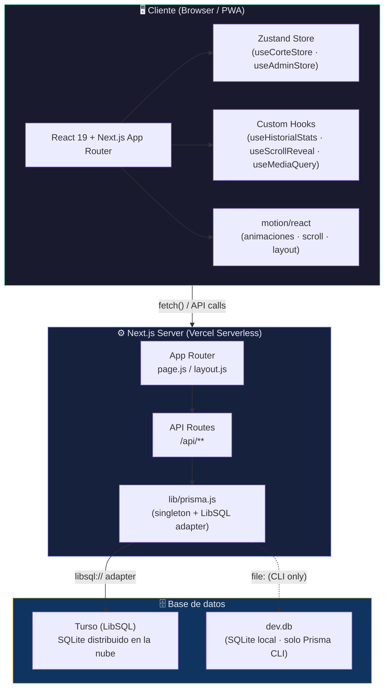
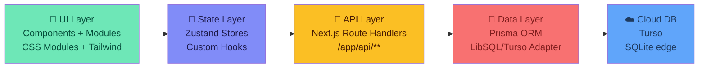
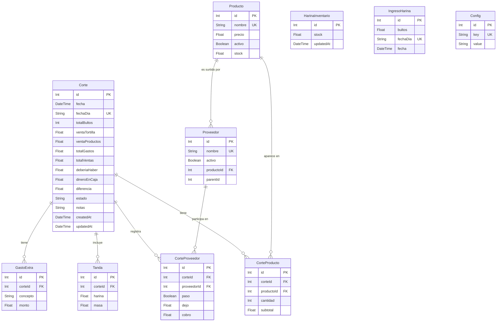
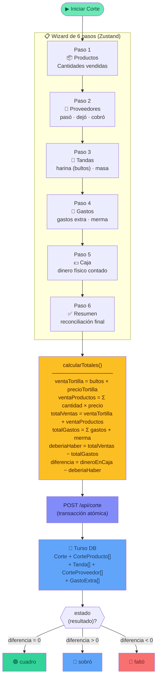
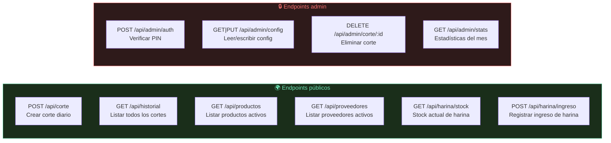
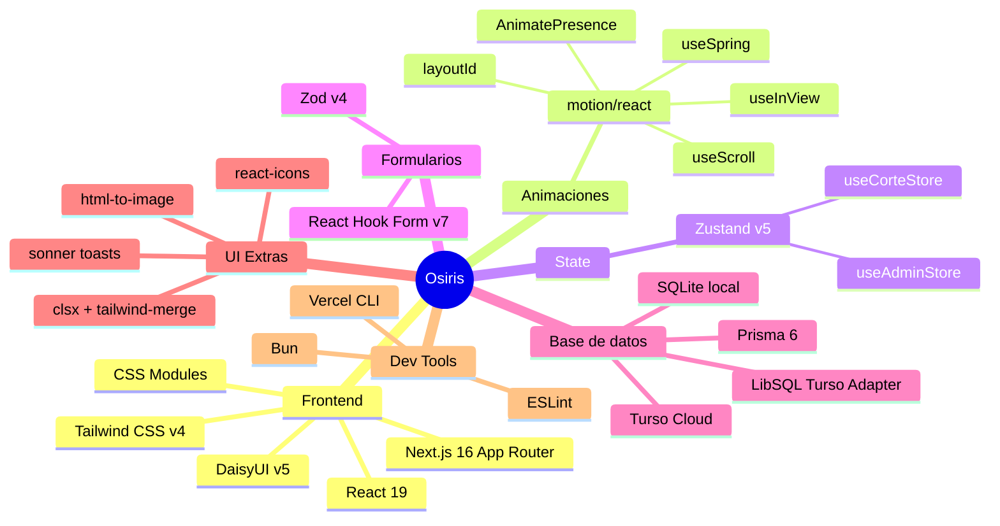
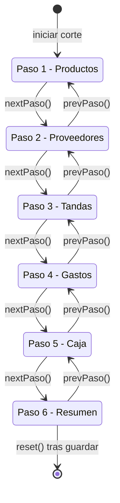
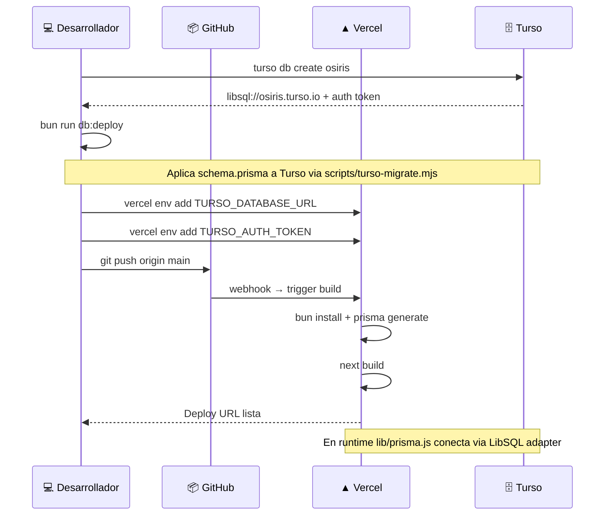
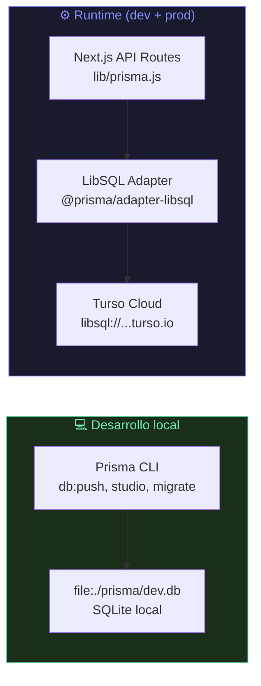
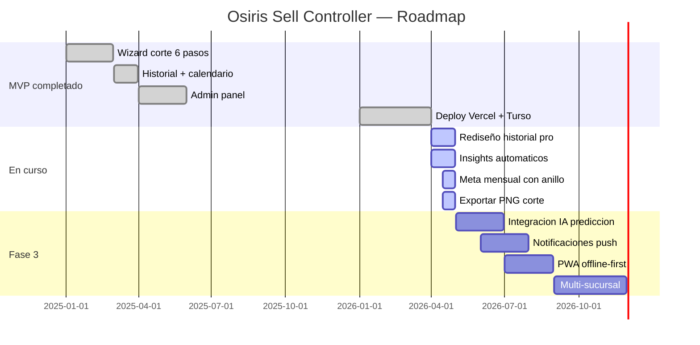

<div align="center">

# 🌿 Osiris Sell Controller

### Sistema de control de ventas para tortillería — moderno, glassmorphic, mobile-first

[](https://nextjs.org)
[](https://react.dev)
[](https://prisma.io)
[](https://turso.tech)
[](https://tailwindcss.com)
[](https://zustand-demo.pmnd.rs)
[](https://vercel.com)


</div>

---

## 📖 Tabla de contenido

- [Visión general](#-visión-general)
- [Arquitectura del sistema](#-arquitectura-del-sistema)
- [Modelo de datos](#-modelo-de-datos-erd)
- [Flujo del corte diario](#-flujo-del-corte-diario)
- [API Reference](#-api-reference)
- [Estructura del proyecto](#-estructura-del-proyecto)
- [Tech Stack detallado](#-tech-stack-detallado)
- [State management (Zustand)](#-state-management-zustand)
- [Hooks personalizados](#-hooks-personalizados)
- [Guía de instalación](#-guía-de-instalación)
- [Variables de entorno](#-variables-de-entorno)
- [Deploy en Vercel + Turso](#-deploy-en-vercel--turso)
- [Comandos útiles](#-comandos-útiles)
- [Diseño — Design Tokens](#-diseño--design-tokens)
- [Roadmap](#-roadmap)

---

## 🎯 Visión general

**Osiris Sell Controller** es una PWA mobile-first para controlar el negocio diario de una tortillería. Registra ventas, producción, proveedores y gastos en un **corte diario** (turno), reconcilia el efectivo en caja y genera historial con análisis automático.

### ¿Qué resuelve?

| Problema real                          | Solución en Osiris                               |
| -------------------------------------- | ------------------------------------------------ |
| Contar a mano cuánto se vendió         | Formulario paso a paso con cálculo automático    |
| No saber si cuadra la caja             | Reconciliación automática: _debe haber_ vs _hay_ |
| Perder registro de proveedores del día | Módulo de proveedores por corte                  |
| Sin historial de producción            | Calendario con cortes pasados + analytics        |
| Inventario de harina desconocido       | Control de stock con ingreso diario              |

---

## 🏗 Arquitectura del sistema



### Patrón de capas



---

## 📊 Modelo de datos (ERD)



---

## 🔄 Flujo del corte diario



---

## 🌐 API Reference

### Mapa de endpoints



### Tabla completa

| Método   | Ruta                    | Body / Query                                                                    | Descripción                            |
| -------- | ----------------------- | ------------------------------------------------------------------------------- | -------------------------------------- |
| `POST`   | `/api/corte`            | `{ productos, tandas, proveedores, gastosExtra, mermaKg, dineroEnCaja, notas }` | Crea corte completo en una transacción |
| `GET`    | `/api/historial`        | —                                                                               | Historial con relaciones completas     |
| `GET`    | `/api/productos`        | `?all=true` para incluir inactivos                                              | Lista de productos                     |
| `POST`   | `/api/productos`        | `{ nombre, precio }`                                                            | Crear producto                         |
| `PUT`    | `/api/productos/[id]`   | `{ nombre?, precio?, activo?, stock? }`                                         | Actualizar producto                    |
| `DELETE` | `/api/productos/[id]`   | —                                                                               | Eliminar producto                      |
| `GET`    | `/api/proveedores`      | —                                                                               | Lista con jerarquía parent-child       |
| `POST`   | `/api/proveedores`      | `{ nombre, productoId?, parentId? }`                                            | Crear proveedor                        |
| `PUT`    | `/api/proveedores/[id]` | `{ nombre?, activo?, productoId?, parentId? }`                                  | Actualizar proveedor                   |
| `DELETE` | `/api/proveedores/[id]` | —                                                                               | Eliminar proveedor                     |
| `GET`    | `/api/harina/stock`     | —                                                                               | Stock actual en bultos                 |
| `PUT`    | `/api/harina/stock`     | `{ stock }`                                                                     | Actualizar stock                       |
| `GET`    | `/api/harina/ingreso`   | —                                                                               | Ingreso del día actual                 |
| `POST`   | `/api/harina/ingreso`   | `{ bultos }`                                                                    | Registrar ingreso diario               |
| `POST`   | `/api/admin/auth`       | `{ pin }`                                                                       | Verificar PIN de admin                 |
| `GET`    | `/api/admin/config`     | `?key=KEY`                                                                      | Leer configuración                     |
| `PUT`    | `/api/admin/config`     | `{ key, value }`                                                                | Escribir configuración                 |
| `DELETE` | `/api/admin/corte/[id]` | —                                                                               | Eliminar corte y revertir inventario   |
| `GET`    | `/api/admin/stats`      | —                                                                               | Estadísticas del mes                   |

---

## 📁 Estructura del proyecto

```
osiris-sell-controller/
│
├── 📂 src/
│   ├── 📂 app/                         # Next.js App Router
│   │   ├── 📂 api/                     # Route Handlers (serverless)
│   │   │   ├── admin/
│   │   │   │   ├── auth/route.js       # POST — verificar PIN admin
│   │   │   │   ├── config/route.js     # GET|PUT — configuración global
│   │   │   │   ├── corte/[id]/route.js # DELETE — eliminar corte
│   │   │   │   └── stats/route.js      # GET — estadísticas del mes
│   │   │   ├── corte/route.js          # POST — crear corte diario
│   │   │   ├── harina/
│   │   │   │   ├── ingreso/route.js    # GET|POST — ingreso diario de harina
│   │   │   │   └── stock/route.js      # GET|PUT — stock actual
│   │   │   ├── historial/route.js      # GET — historial completo
│   │   │   ├── productos/
│   │   │   │   ├── route.js            # GET|POST
│   │   │   │   └── [id]/route.js       # PUT|DELETE
│   │   │   └── proveedores/
│   │   │       ├── route.js            # GET|POST
│   │   │       └── [id]/route.js       # PUT|DELETE
│   │   │
│   │   ├── admin/page.jsx              # 🔒 Panel de administración
│   │   ├── corte/page.js               # 📋 Wizard del corte (6 pasos)
│   │   ├── historial/page.jsx          # 📊 Historial + analytics
│   │   ├── inventario/page.jsx         # 📦 Inventario de productos y harina
│   │   ├── calendario/page.jsx         # 📅 Vista calendario de cortes
│   │   ├── page.js                     # 🏠 Home / landing
│   │   ├── layout.js                   # Root layout (fuentes, providers)
│   │   └── globals.css                 # Design tokens + utilidades globales
│   │
│   ├── 📂 components/                  # Componentes reutilizables
│   │   ├── HomeActions.js              # Botones de acción principal en home
│   │   ├── cards/
│   │   │   ├── ActionCard/             # Card clicable con icono y flecha
│   │   │   ├── GlassCard/              # Wrapper glassmorphism base
│   │   │   └── Section/                # Sección animada con scroll reveal
│   │   ├── modals/
│   │   │   └── HarinaModal/            # Modal para ingreso de harina
│   │   └── navigation/
│   │       ├── BottomNav/              # Barra de navegación inferior
│   │       ├── NavButton/              # Controles Anterior/Siguiente
│   │       └── Stepper/                # Indicador visual de pasos
│   │
│   ├── 📂 hooks/                       # Hooks personalizados
│   │   ├── useHistorialStats.js        # Agregados del historial (racha, sparkline…)
│   │   ├── useMediaQuery.js            # Re-export de @mantine/hooks
│   │   └── useScrollReveal.js          # Fade-up con useInView (motion)
│   │
│   ├── 📂 lib/
│   │   ├── prisma.js                   # Singleton Prisma + LibSQL adapter
│   │   └── utils.js                    # Helpers (cn, formatCurrency…)
│   │
│   ├── 📂 modules/                     # Feature modules (UI + lógica)
│   │   ├── corte/                      # Wizard del corte
│   │   │   ├── index.js                # Orquestador de pasos
│   │   │   ├── Productos.js            # Paso 1 — ventas por producto
│   │   │   ├── Proveedores.js          # Paso 2 — proveedores del día
│   │   │   ├── Tandas.js               # Paso 3 — producción de masa
│   │   │   ├── Gastos.js               # Paso 4 — gastos extra + merma
│   │   │   ├── Caja.js                 # Paso 5 — efectivo en caja
│   │   │   ├── Summary.js              # Paso 6 — reconciliación final
│   │   │   └── styles/                 # CSS Modules por módulo
│   │   └── historial/                  # Historial & analytics
│   │       ├── Calendario.jsx          # Calendario mensual con layoutId
│   │       ├── DetalleCorte.jsx        # Panel de detalle completo
│   │       ├── InsightsCard.jsx        # Insights automáticos + sparkline
│   │       ├── MetaMensual.jsx         # Meta mensual con anillo SVG
│   │       └── ShareCorte.jsx          # Exportar/compartir como PNG
│   │
│   └── 📂 stores/                      # Zustand stores
│       ├── useCorteStore.js            # Estado del wizard del corte
│       └── useAdminStore.js            # Autenticación de admin
│
├── 📂 prisma/
│   ├── schema.prisma                   # Esquema de la base de datos
│   ├── seed.js                         # Datos iniciales
│   └── dev.db                          # SQLite local (solo desarrollo)
│
├── 📂 scripts/
│   └── turso-migrate.mjs               # Deploy del schema a Turso
│
├── 📂 public/
│   ├── images/                         # Imágenes (bg.jpg, etc.)
│   ├── svg/
│   ├── fonts/
│   └── lotties/                        # Animaciones Lottie
│
├── .env                                # Variables de entorno (no commitear)
├── .env.example                        # Plantilla de variables
├── package.json
└── README.md
```

---

## 🛠 Tech Stack detallado



### Por qué este stack

| Tecnología         | Por qué                                                                  |
| ------------------ | ------------------------------------------------------------------------ |
| **Next.js 16**     | SSR + API Routes en un solo proyecto, deploy sin config en Vercel        |
| **Turso + LibSQL** | SQLite serverless con 500 DBs gratis, latencia edge, sin servidor propio |
| **Prisma 6**       | Type-safe ORM, migraciones, Prisma Studio para inspeccionar datos        |
| **Zustand**        | Estado global mínimo sin boilerplate; persiste entre pasos del wizard    |
| **motion/react**   | Animaciones declarativas con layout animations y scroll-driven effects   |
| **CSS Modules**    | Scoping por componente + tokens globales en `globals.css`                |
| **DaisyUI v5**     | Componentes listos para glassmorphism sobre Tailwind                     |

---

## 🧠 State management (Zustand)

### useCorteStore — el corazón del wizard



### Fórmula de reconciliación

```js
// calcularTotales() en useCorteStore.js
const ventaTortilla  = totalBultos  * precioTortilla     // bultos × precio config
const ventaProductos = Σ (cantidad[id] * precio[id])     // todos los productos
const totalVentas    = ventaTortilla + ventaProductos
const totalGastos    = Σ gastos.monto + (mermaKg * 22)   // $22/kg merma
const deberiaHaber   = totalVentas   - totalGastos
const diferencia     = dineroEnCaja  - deberiaHaber
const estado         = diferencia === 0 ? 'cuadro'
                     : diferencia >   0 ? 'sobro'
                     :                    'falto'
```

---

## 🪝 Hooks personalizados

### `useHistorialStats(cortes[])`

```js
// Retorna:
{
  totalMes,          // Float — ventas totales del mes actual
  promedioVentas,    // Float — promedio por día
  coincidencia,      // Number 0-100 — % de días que cuadró la caja
  rachaActual,       // Number — días consecutivos cuadrando
  mejorDia,          // String — "lunes", "martes"… (más ventas en promedio)
  productoEstrella,  // String — producto con más unidades vendidas
  sparkline,         // Float[] — ventas por día del mes (para SVG)
  insights,          // String[] — frases automáticas con reglas simples
}
```

### `useScrollReveal({ amount, once, margin })`

```js
import { useScrollReveal, fadeUp } from '@/hooks/useScrollReveal'

const { ref, inView } = useScrollReveal({ amount: 0.2 })

// Usar con motion:
<motion.div
  ref={ref}
  variants={fadeUp}
  initial="hidden"
  animate={inView ? 'show' : 'hidden'}
>
```

### `useMediaQuery(query)`

```js
import { useMediaQuery } from '@/hooks/useMediaQuery';

const isDesktop = useMediaQuery('(min-width: 768px)');
// → true en desktop, false en mobile
```

---

## 🚀 Guía de instalación

### Prerrequisitos

```
Node.js >= 18
Bun >= 1.0      (recomendado, o npm/pnpm)
Git
```

### 1. Clonar e instalar

```bash
git clone https://github.com/tu-usuario/osiris-sell-controller.git
cd osiris-sell-controller
bun install
```

### 2. Configurar variables de entorno

```bash
cp .env.example .env
# Editar .env con tus valores (ver sección Variables de entorno)
```

### 3. Preparar base de datos local

```bash
# Generar cliente Prisma
bunx prisma generate

# Crear SQLite local y aplicar schema
bunx prisma db push

# (Opcional) Cargar datos de ejemplo
bun run db:seed
```

### 4. Iniciar en desarrollo

```bash
bun run dev
# → http://localhost:3000
```

> 💡 **Tip:** Abre `bunx prisma studio` en otra terminal para ver y editar datos visualmente en `localhost:5555`.

---

## 🔐 Variables de entorno

```bash
# ── Prisma CLI (solo local: db:push, studio, migrate) ──────────────────────
DATABASE_URL="file:./prisma/dev.db"

# ── Turso — runtime en producción (y en db:deploy) ─────────────────────────
TURSO_DATABASE_URL="libsql://tu-db.aws-us-east-1.turso.io"
TURSO_AUTH_TOKEN="eyJhbGci..."
```

| Variable             | Requerida | Descripción                         |
| -------------------- | --------- | ----------------------------------- |
| `DATABASE_URL`       | ✅ Dev    | URL SQLite local para CLI de Prisma |
| `TURSO_DATABASE_URL` | ✅ Prod   | URL de la base de datos Turso       |
| `TURSO_AUTH_TOKEN`   | ✅ Prod   | Token JWT de autenticación Turso    |

> ⚠️ **Nunca** subas `.env` a Git. Usa `.env.example` como plantilla.

---

## ☁️ Deploy en Vercel + Turso

### Diagrama de deployment



### Pasos de deployment

```bash
# 1. Crear DB en Turso (si no existe)
turso db create osiris
turso db tokens create osiris

# 2. Copiar credenciales a .env

# 3. Desplegar schema a Turso
bun run db:deploy

# 4. Agregar env vars a Vercel
vercel env add TURSO_DATABASE_URL production
vercel env add TURSO_AUTH_TOKEN production

# 5. Deploy
vercel --prod
```

### Estrategia dual de base de datos



> **Clave:** `DATABASE_URL=file:./dev.db` para que el CLI de Prisma funcione en local. `TURSO_DATABASE_URL` + `TURSO_AUTH_TOKEN` para el runtime via `lib/prisma.js`.

---

## ⚡ Comandos útiles

```bash
# ── Desarrollo ──────────────────────────────────────────
bun run dev              # Iniciar servidor dev → localhost:3000
bun run build            # Build de producción
bun run lint             # Linter (ESLint)

# ── Base de datos ────────────────────────────────────────
bun run db:push          # Push schema → SQLite local (sin migraciones)
bun run db:migrate       # Crear y aplicar migración (dev)
bun run db:deploy        # Desplegar schema a Turso en la nube
bun run db:seed          # Poblar DB con datos de ejemplo
bun run db:studio        # Abrir Prisma Studio en localhost:5555

# ── Prisma ───────────────────────────────────────────────
bunx prisma generate     # Re-generar cliente Prisma
bunx prisma format       # Formatear schema.prisma
bunx prisma validate     # Validar schema
```

---

## 🎨 Diseño — Design Tokens

### Paleta de colores

| Token               | Valor               | Uso                              |
| ------------------- | ------------------- | -------------------------------- |
| `--color-primary`   | `#6ee7b7` esmeralda | Acciones principales, checkmarks |
| `--color-secondary` | `#818cf8` índigo    | Acentos, badges secundarios      |
| `--color-accent`    | `#fbbf24` ámbar     | Advertencias, highlights         |
| `--color-base-100`  | `#0d0d0f`           | Fondo principal                  |
| `--color-success`   | `#34d399`           | Estado "cuadro"                  |
| `--color-error`     | `#f87171`           | Estado "faltó"                   |
| `--color-info`      | `#60a5fa`           | Estado "sobró"                   |

### Glassmorphism — receta base

```css
/* Aplicar a cualquier card */
background: var(--glass-bg); /* rgba(255,255,255,0.04) */
border: 1px solid var(--glass-border); /* rgba(255,255,255,0.08) */
backdrop-filter: var(--glass-blur); /* blur(8px) */

box-shadow: var(--glass-shadow); /* 0 8px 32px rgba(0,0,0,0.4) */
border-radius: 16px;

/* O simplemente: */
.glass {
  /* clase utilitaria en globals.css */
}
```

---

## 🗺 Roadmap



### Features planificadas

- [ ] 🤖 **IA de predicción** — Sugerir cuánta harina pedir según histórico de producción
- [ ] 📲 **PWA offline-first** — Funcionar sin internet y sincronizar al reconectar
- [ ] 🔔 **Push notifications** — Recordatorio diario del corte
- [ ] 📊 **Dashboard ejecutivo** — Gráficas de tendencias semana/mes
- [ ] 🏪 **Multi-sucursal** — Soporte para múltiples puntos de venta
- [ ] 📱 **App nativa** — Wrapper Capacitor para iOS/Android

---

## 🤝 Contribuir

```bash
# 1. Fork del repositorio
# 2. Crear rama de feature
git checkout -b feature/mi-feature

# 3. Commits convencionales
git commit -m "feat: agregar gráfica de tendencias semanal"
git commit -m "fix: reconciliación con gastos negativos"
git commit -m "style: mejorar responsive del corte wizard"

# 4. Push y Pull Request
git push origin feature/mi-feature
```

### Convenciones de código

- **Componentes**: PascalCase + `.module.css` sibling
- **Hooks**: camelCase con prefijo `use`
- **API routes**: `export async function GET/POST/PUT/DELETE(req)`
- **CSS**: tokens en `globals.css`, estilos locales en `.module.css`
- **Commits**: [Conventional Commits](https://conventionalcommits.org/)

---

<div align="center">

**Osiris Sell Controller** — Hecho con 💚 y glassmorphism

_Next.js · Turso · Prisma · motion/react · Zustand · Tailwind_

</div>
